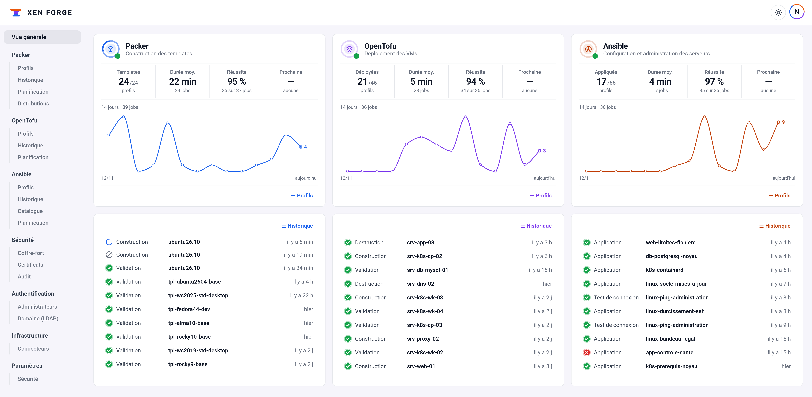

# Xen Forge

<picture>
  <source media="(prefers-color-scheme: dark)" srcset="images/dark.png">
  <source media="(prefers-color-scheme: light)" srcset="images/light.png">
  
</picture>

## Sommaire

- [Fonctionnalités](#fonctionnalités)
- [Prérequis](#prérequis)
- [Flux réseau](#flux-réseau)
- [Installation](#installation)
- [Exploitation](#exploitation)
- [Sécurité et accès](#sécurité-et-accès)
- [Personnalisation](#personnalisation)
- [Licence](#licence)

## Fonctionnalités

### Construction des templates (Packer)

- **Catalogue d'ISO officielles** par distribution et version, extensible, avec vérification des empreintes.
- **Installation entièrement automatique :** fichiers de réponse générés pour chaque famille de systèmes.
- **Profils complets :** processeurs, mémoire, disque, stockage, réseau DHCP ou IP fixe, nom d'hôte, fuseau horaire, langue, clavier, IPv6, BIOS ou UEFI avec Secure Boot.
- **Personnalisation :** mises à jour de l'OS, paquets et commandes supplémentaires, comportement si le template existe déjà (refuser, remplacer, remplacer et supprimer les disques), conservation de la VM pour diagnostic.
- **Windows Server :** choix de l'édition, clé de produit, Windows Update, commandes PowerShell, cloudbase-init et sysprep.
- **Planification :** date et heure précises, ou exécution périodique par jours et semaines du mois, avec activation et désactivation.

### Déploiement des VM (OpenTofu)

- **Déploiement depuis un template :** via Xen Orchestra, en clone rapide ou complet, avec validation, construction et destruction.
- **Configuration au premier démarrage :** cloud-init sous Linux, cloudbase-init sous Windows.
- **Machine virtuelle :** vCPU et topologie, mémoire, plusieurs disques et interfaces réseau, DHCP ou IP fixe, hôte d'affinité, étiquettes, paramètres Xen.
- **Personnalisation :** paquets, commandes, commandes PowerShell, données utilisateur cloud-init personnalisées.
- **Self-service :** partage de la VM avec un groupe et attribution à un utilisateur ou groupe Xen Orchestra.
- **Import :** prise en charge d'une VM existante.
- **Planification :** construction ou destruction de la VM d'un profil, à date et heure précises ou périodiquement.

### Configuration des serveurs (Ansible)

- **Profils Linux et Windows :** étapes tirées du catalogue de briques, ou playbook YAML, sur des VM déployées par Xen Forge ou des serveurs saisis à la main (SSH, WinRM en HTTPS).
- **Catalogue :** briques livrées avec l'application, en lecture seule et clonables, et briques personnelles en fichiers YAML dans `forge-ansible/catalogue`.
- **Planification :** application d'un profil, à date et heure précises ou périodiquement.

### Suivi et exploitation

- **Vue générale** de l'activité Packer, OpenTofu et Ansible.
- **Jobs :** journal en direct, historique, annulation, relance, archive téléchargeable.
- **Actions groupées :** recherche, tri et traitement de plusieurs profils ou jobs, clonage de profils.
- **Connecteurs :** hôtes XCP-ng et Xen Orchestra.

### Sécurité et accès

- **Coffre-fort chiffré :** mots de passe, clés SSH générées ou importées, clés de produit Windows.
- **Certificats :** certificat et clé privée, PKCS12 ou autorité (CA), contrôlés à l'import (chaîne, correspondance de la clé, mot de passe).
- **Authentification :** comptes locaux, annuaire LDAP et LDAPS, double authentification TOTP.
- **Accès :** HTTPS uniquement, certificat fourni ou auto-signé, journal d'audit des actions.

## Prérequis

- **Machine d'installation :** Linux avec Docker Engine et Docker Compose 2.17 ou plus récent.
- **XCP-ng :** un hôte autonome ou un pool, avec l'accès SSH root activé sur chaque hôte (utilisé par le plugin Packer).
- **Xen Orchestra :** une instance qui gère cet hôte ou ce pool, joignable en HTTPS depuis la machine d'installation.

## Flux réseau

| **Source** | **Destination** | **Port** | **Usage** |
|---|---|---|---|
| Postes d'administration | Xen Forge | TCP 443 | Interface web |
| Xen Forge | XCP-ng | TCP 443 | API XAPI, envoi des ISO, console VNC encapsulée pour la commande de démarrage |
| Xen Forge | XCP-ng | TCP 22 | SSH root du plugin Packer : détection de l'adresse de l'application vue par l'hôte, avant la commande de démarrage. Tous les builds, Windows compris. Dans un pool, ouvrez ce flux vers chaque membre |
| Xen Forge | Xen Orchestra | TCP 443 | Déploiements OpenTofu et API Xen Orchestra (WebSocket sécurisé) |
| Xen Forge | Réseau de construction | TCP 22 | SSH de Packer vers la VM de build : post-installation et nettoyage |
| Réseau de construction | Xen Forge | TCP 8080 | Builds Linux : fichiers d'installation et remontée de l'adresse IP. Non utilisé par Windows |
| Réseau de construction | DNS et Internet ou miroirs | UDP/TCP 53, TCP 80 et 443 | Paquets et mises à jour pendant le build |
| Réseau de déploiement | DNS et Internet ou miroirs | UDP/TCP 53, TCP 80 et 443 | Uniquement si la VM installe des paquets au premier démarrage |
| Xen Forge | Internet | TCP 443 | Téléchargement des ISO et des empreintes |
| Xen Forge | Annuaire LDAP | TCP 389 ou 636 | Authentification, si LDAP est activé |
| Xen Forge | Serveurs ciblés par Ansible | TCP 22 et 5986 | Ansible : SSH vers Linux et Windows, WinRM HTTPS vers Windows |


## Installation

### 1. Récupérer le projet

```sh
git clone https://github.com/RunasRs/Xen-Forge.git
cd Xen-Forge
cp .env.example .env
chmod 600 .env
sudo chown -R 1000:1000 forge-ansible/catalogue
```

### 2. Renseigner `.env`

Les versions et les empreintes des composants sont déjà remplies. Il reste à définir :

| **Variable** | **Valeur** |
|---|---|
| `APP_NAME` | Nom de domaine de l'application, par exemple `forge.example.org` |
| `APP_SECRET_KEY` | Résultat de `openssl rand -base64 32` |
| `POSTGRES_PASSWORD` | Mot de passe de la base de données |

#### Serveurs DNS (facultatif)

Par défaut, les conteneurs utilisent les serveurs DNS de la machine. Pour en utiliser d'autres :

| **Variable** | **Valeur** |
|---|---|
| `DNS1` | Adresse IP du serveur DNS principal |
| `DNS2` | Adresse IP du serveur DNS secondaire (facultative) |


### 3. Ajouter un certificat (facultatif)

Sans certificat, l'application en crée un auto-signé pour `APP_NAME`.

```sh
cp /chemin/certificat-et-intermediaires.pem ssl/cert.crt
cp /chemin/cle-non-chiffree.pem ssl/cert.key
chmod 700 ssl
chmod 600 ssl/cert.key
sudo chown -R 1000:1000 ssl
```

### 4. Construire et démarrer

```sh
sudo docker compose up -d --build
```
Vérification :
```
curl -k https://localhost/health
```

### 5. Première connexion

Au premier démarrage, l'application crée le compte local `admin` avec un mot de passe temporaire aléatoire.

```sh
sudo docker exec -it forge-app adminpasswd
```

### 6. Configurer l'application

1. **Infrastructure › Connecteurs :** ajoutez les hôtes XCP-ng et Xen Orchestra.
2. **Sécurité › Coffre-fort :** créez le compte des VM. Une entrée est obligatoire pour créer un profil.
3. **Packer › Profils :** créez un profil, puis lancez **Construire**.
4. **OpenTofu › Profils :** choisissez le template obtenu et déployez une VM.
5. **Ansible › Profils :** choisissez la VM déployée et appliquez des briques du catalogue, livrées ou personnalisées.

## Exploitation

| **Action** | **Commande** |
|---|---|
| Prendre en compte un nouveau certificat | `sudo docker compose restart app` |
| Sauvegarder la base de données | `sudo docker exec forge-db sh -c 'pg_dump -U "$POSTGRES_USER" -d "$POSTGRES_DB" -Fc' > forge.dump` |
| Restaurer la base de données | `sudo docker stop forge-app && sudo docker exec -i forge-db sh -c 'pg_restore -U "$POSTGRES_USER" -d "$POSTGRES_DB" --clean --if-exists --no-owner' < forge.dump && sudo docker start forge-app` |

### Sauvegarde

À sauvegarder ensemble :
- la base de données (commande ci-dessus) ;
- `.env`, qui contient `APP_SECRET_KEY` ;
- `forge-ansible/catalogue` (briques personnelles) et `ssl` (certificat fourni) ;
- facultatif, pour garder les journaux des jobs : les volumes `forge_jobs-packer`, `forge_jobs-tofu` et `forge_jobs-ansible`.

### Mise à jour

1. Sauvegardez la base de données et `.env`.
2. Récupérez la nouvelle version : `git pull`.
3. Reportez dans `.env` les versions et empreintes modifiées de `.env.example` : `diff .env.example .env`
4. Reconstruisez et redémarrez : `sudo docker compose up -d --build`

### Compte administrateur perdu

Mot de passe perdu ou annuaire LDAP injoignable :

```sh
sudo docker exec -it forge-app adminreset
```
```sh
sudo docker exec -it forge-app adminpasswd
```
## Personnalisation
Les briques Ansible livrées avec l'application sont en lecture seule, mais chacune peut être clonée puis modifiée librement. Vous pouvez aussi écrire vos propres briques en fichiers YAML, à déposer dans `forge-ansible/catalogue` ou à importer depuis l'interface web, en vous appuyant sur les collections ci-dessous.

| **Ansible Collection**| **Version** | **Usage** |
|---|---|---|
| `ansible.builtin` | 2.20.10 | paquets, services, fichiers, utilisateurs, commandes, redémarrage |
| `ansible.posix` | 2.0.0 | firewalld, SELinux, sysctl, montages, clés SSH autorisées |
| `ansible.windows` | 3.9.2 | rôles et fonctionnalités, Windows Update, services, logiciels, registre, utilisateurs et groupes |
| `community.general` | 10.7.0 | ufw, zypper, fuseau horaire, modules du noyau, LVM et nombreux outils système |
| `community.crypto` | 3.5.1 | clés privées, demandes de certificat, certificats autosignés |
| `community.windows` | 3.3.0 | règles de pare-feu, tâches planifiées, IIS, partages, journaux d'événements |
| `microsoft.ad` | 1.12.1 | intégration au domaine, comptes, groupes et unités d'organisation Active Directory |

---

**Systèmes pris en charge (Packer)**

| **Famille** | **Versions** |
|---|---|
| Debian | 11, 12, 13 |
| Kali | 2026.3 |
| Ubuntu Server | 24.04, 26.04, 26.10 |
| Fedora Server | 42, 43, 44 |
| Rocky Linux | 8, 9, 10 |
| AlmaLinux | 8, 9, 10 |
| Oracle Linux | 8, 9, 10 |
| openSUSE Leap | 15.6, 16.1 |
| Windows Server | 2019, 2022, 2025 |

## Licence

Xen Forge est distribué sous la [PolyForm Noncommercial License 1.0.0](LICENSE) : usage personnel et non commercial autorisé, usage commercial interdit sans accord.
